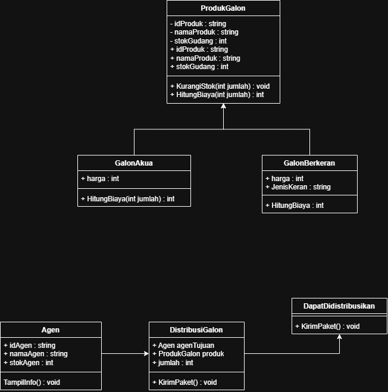

# Mafia Galon

Program Mafia Galon dibuat menggunakan bahasa C# untuk menerapkan konsep Pemrograman Berorientasi Objek (PBO).

## Class Diagram

## Penjelasan Program

### Soal 1 – Class dan Object
Membuat class `Agen` dengan atribut `idAgen`, `namaAgen`, dan `stokAgen`. Method `TampilInfo()` digunakan untuk menampilkan informasi agen. Pada Main Program dibuat dua object agen.

### Soal 2 – Encapsulation
Menerapkan encapsulation pada class `ProdukGalon` dengan menggunakan atribut private dan property getter serta setter. Pengurangan stok dilakukan melalui method `KurangiStok()` agar stok tidak bisa dikurangi secara sembarangan.

### Soal 3 – Inheritance
Class `GalonAkua` dan `GalonBerkeran` mewarisi class `ProdukGalon`. Class `GalonBerkeran` memiliki atribut tambahan yaitu `jenisKeran`.

### Soal 4 – Polymorphism
Menerapkan polymorphism melalui method `HitungBiaya()`. Setiap class turunan memiliki perhitungan biaya yang berbeda sesuai jenis galonnya.

### Soal 5 – Abstract Class
Class `ProdukGalon` diubah menjadi abstract class. Method `HitungBiaya()` juga dibuat abstract sehingga wajib diimplementasikan oleh class turunannya.

### Soal 6 – Interface
Membuat interface `DapatDidistribusikan` yang diimplementasikan oleh class `DistribusiGalon`. Method `KirimPaket()` digunakan untuk memvalidasi dan melakukan pengiriman galon dari gudang ke agen.

### Soal 7 – Aggregation
Membuat class `SindikatGalon` yang menyimpan kumpulan object `Agen` dan `ProdukGalon` menggunakan List. Class ini memiliki method untuk menambah dan menampilkan data.

## Pengujian Program

Pengujian dilakukan melalui Main Program dengan hasil:

- Perhitungan 5 galon Akua: Rp100.000.
- Perhitungan 5 galon Berkeran: Rp60.000.
- Stok gudang sebelum distribusi: 100 galon.
- Stok gudang setelah distribusi: 80 galon.
- Stok agen sebelum distribusi: 10 galon.
- Stok agen setelah distribusi: 30 galon.

## Kesimpulan

Program Mafia Galon berhasil menerapkan konsep class dan object, encapsulation, inheritance, polymorphism, abstract class, interface, dan aggregation menggunakan bahasa C#.
